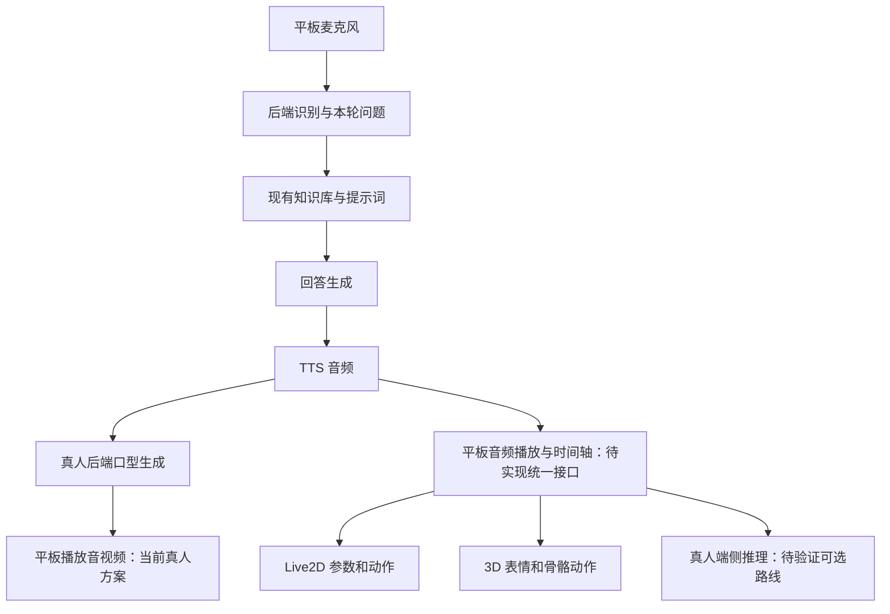

# 安卓平板数字人方案：2D 真人、Live2D 与 3D 动漫

更新日期：2026-10-14。适用项目：LiveTalking / Flutter 安卓平板 App。

本文基于当前代码、连接平板的原型测试，以及公开商品页整理。明确区分“已实现”“建议方案”和“尚未验证”；价格是素材或制作费用，不包含开发、算力、语音与大模型服务费用。

## 1. 目标与端侧的含义

目标是在安卓平板上竖屏全屏展示数字人，保留开始、麦克风、打断、形象选择和服务器设置等按钮，复用现有一问一答、知识库、公司背景及回答边界。

“数字人端侧”在本文指：角色画面的渲染或生成发生在平板上。它不等于整个问答系统离线运行。语音识别、知识库、大模型和语音合成可以继续在后端运行。

需要区分三个层次：

| 层次 | 平板负责什么 | 是否需要后端生成角色视频 |
| --- | --- | --- |
| 端侧播放 | 解码并播放后端传来的音视频 | 需要，当前真人模式属于此类 |
| 端侧渲染 | 本地加载人物素材，驱动参数、骨骼与表情 | 不需要，Live2D 和 3D VRM 属于此类 |
| 端侧神经网络生成 | 本地根据声音，用模型生成真人嘴部图像 | 不需要，但需移植推理模型并验证性能 |

当前项目不能统一称为“全部端侧数字人”。真人模式仍依赖后端视频生成；Live2D 本地渲染已实现；3D 本地渲染已实现原型，正式问答音频驱动尚未接入。

## 2. 三种方案对比

| 对比项 | 2D 真人 | 2D Live2D | 3D 动漫 / VRM |
| --- | --- | --- | --- |
| 人物素材 | 肖像、真人或合成人物视频、人脸预处理数据 | 分层画稿制作的绑定模型 | 网格、纹理、骨骼、表情组成的模型 |
| 当前项目画面在哪生成 | 后端 Wav2Lip 生成，平板播放 | 平板 Cubism 渲染 | 平板 WebView / WebGL 渲染 |
| 真正端侧实现难度 | 高：动态真人口型推理尚未移植 | 低至中：已有渲染，主要补音频同步 | 中：已有原型，主要补动作、同步和性能 |
| 嘴形来源 | 音频特征驱动图像生成 | 嘴部参数变化 | 表情权重，例如 aa / ih / ou / ee / oh |
| 身体动作来源 | 原始视频；额外生成身体动作是另一项工作 | 模型已有 motion 和参数 | 骨骼动画、VRMA 或重定向动画 |
| 可转身、改变视角 | 受拍摄素材限制 | 有限的二维形变 | 可以，在模型及动作支持的范围内 |
| 对平板的压力 | 当前播放较轻；本地推理压力较大 | 取决于纹理、网格、遮罩和模型复杂度 | 取决于面数、材质、纹理、物理和渲染分辨率 |
| 主要持续成本 | 当前有后端视频推理、编码和传输成本 | 后端问答与语音服务；SDK 授权按条款判断 | 后端问答与语音服务；模型授权按条款判断 |
| 学校场景适配 | 成熟教师、校务咨询、正式接待 | 亲切教师、学生、校园助手 | 学生助手、互动教学、可展示肢体动作的角色 |

素材购买只能解决人物外观及已有绑定能力，不能自动解决中文口型、动作与回答内容同步、平板流畅度。

## 3. 2D 真人：当前实现与端侧路线

### 3.1 当前项目如何实现

当前 `config.yaml` 使用 `model: wav2lip`、`avatar_id: wav2lip_business_consultant_v2`，嘴部融合强度为 `0.45`。

流程如下：

1. 准备睁眼肖像与闭眼肖像。`scripts/build_blink_avatar.py` 默认生成 576 × 768、25 FPS、100 帧的眨眼循环视频；闭眼动作通过眼部区域混合完成。
2. 对视频提取完整帧、人脸裁剪和人脸坐标，形成 `full_imgs`、`face_imgs` 和 `coords.pkl`。
3. 回答文本经 TTS 合成音频。当前人物后端使用 16 kHz 音频数据，按短音频块进入处理队列。
4. `avatars/audio_features/mel.py` 提取 Mel 音频特征。
5. `avatars/wav2lip_avatar.py` 将原人脸和被遮住下半脸的图像，与音频特征一起送入 Wav2Lip，生成对应的人脸画面。
6. `avatars/lip_blend.py` 只在嘴部及下半脸区域做柔化融合，保留眼睛和上半脸。
7. 后端输出视频与音频，Flutter 通过 WebRTC 接收、解码、播放。

人物眨眼来自素材；嘴部来自声音驱动生成。当前素材以静态肖像为基础，身体动作有限。降低嘴部融合强度可以减轻动作，但也可能使嘴形不够清晰。

这条路线通常不需要给每个新人物重新训练 Wav2Lip。新人物主要需要准备合适素材并预处理，最终效果仍需逐个人物验证。

### 3.2 真正的真人端侧，有哪些实现方式

**路线 A：图片 / 视频 + 本地简单嘴部动画。**

平板本地播放待机素材，根据声音切换嘴部贴图或做局部形变。技术上较轻，但拍摄真人的嘴部与贴图边缘容易不一致，通常很难达到自然真人口型。适合低成本演示，不能与神经网络口型生成混为一谈。

**路线 B：预先生成固定问答视频，端侧选择播放。**

对固定内容预先生成完整说话视频，平板按匹配结果播放。播放压力较小，但只能自然覆盖已生成的内容。开放式回答、修改知识库后的新答案，仍需要重新生成或走另一条链路。视频内的声音与口型必须整体配套，不能随意替换音轨。

**路线 C：在 Android 上运行真人口型推理模型。**

先在电脑上准备人物素材和模型，再尝试转换为 ONNX 或其他移动推理格式，通过 Android 原生插件执行音频特征提取、推理和图像融合，最后用 Surface / Texture 展示。

候选运行环境包括 ONNX Runtime Mobile、LiteRT 或其他移动推理框架；应根据模型算子与目标芯片选择。是否支持量化、GPU / NPU 加速、动态输入，必须实际验证，不能假定转换成功就能实时运行。

本项目尚未完成这条移植。建议先做单独的音频驱动口型基准测试，测模型加载时间、推理 FPS、内存、温度和声音到画面的延迟，再决定是否接入 App。目标是稳定接近 25 FPS，并留出音频和 UI 的运行空间；这是验收目标，不是当前设备已达到的结果。

### 3.3 更适合当前项目的真人升级方式

近期可继续采用“后端生成 + 平板播放”，把静态肖像升级为自然眨眼、轻微点头及身体移动的授权视频，再对比口型算法效果。这能复用现有链路，但身体动作依然受原视频限制，不能按任意回答自由生成手势。

原版 Wav2Lip 明确限制商业使用。当前 `models/wav2lip.pth` 的 256 版本来源与授权仍需追溯；不能因为 LiveTalking 项目使用 Apache 许可证，就认定其所有模型权重可以商用。

MuseTalk 官方说明其代码使用 MIT 许可证，训练模型允许商业使用，依赖模型仍需分别遵守授权。项目已有 MuseTalk 插件，但不能视为已验证最新版 1.5 的 Mac 性能、Android 端侧能力或最终视觉质量。

## 4. 2D Live2D：端侧实现方案

### 4.1 人物素材是什么

Live2D 把画稿中的脸、眼睛、嘴、头发、身体等部分分层绘制，再用变形器和参数绑定制作动态模型。普通动漫图片不能直接替代完整模型。

接入需要完整资源包，通常包括：

| 文件 | 用途 |
| --- | --- |
| `.model3.json` | 模型入口，引用其他资源 |
| `.moc3` | 编译后的绑定模型 |
| 纹理图片 | 人物画面 |
| `.motion3.json` | 待机、点头、招手等已有动作 |
| `.exp3.json` | 表情，模型不一定提供 |
| `.physics3.json` / `.pose3.json` | 物理及姿势配置，按模型需要提供 |

`.moc3` 的制作是美术分层、绑定和调参工作；不是程序把图片裁剪一下就可以完成。

### 4.2 当前项目已经实现的逻辑

Flutter 加载本地 `flutter_live2d` 插件，通过 Android 原生 Cubism / OpenGL 渲染模型，Flutter 背景层展示教室图片。

当前支持 Haru、Ren、Hiyori、Chitose、Shizuku、Hibiki 等模型切换。模型加载完成后启动待机动作；插件按模型声明处理眨眼参数、物理与动作更新。

当前嘴巴逻辑在 `tablet_app/lib/main.dart` 的 `_startHaruMouthAnimation()`：每 80 ms 检查是否处于回答状态，在说话时用正弦函数让嘴巴轻微开合。它没有分析实际播放的音频，也没有识别中文音素。

因此当前 Live2D 是“有说话动作”，尚不是精确的音频口型同步。原生插件已处理声明的 LipSync 参数映射，并在动作等更新后应用嘴部值；接新模型仍需检查嘴部与眨眼的实际绑定。

### 4.3 推荐的正式音频驱动逻辑

1. 后端继续完成识别、知识库、回答与 TTS，输出音频以及可选的动作标签。
2. 平板负责音频解码和播放，并取得实际播放位置。
3. 对将要播放的 PCM 计算音量包络，按播放时间驱动嘴部开合；增加噪声门限、幅度上限和开闭平滑。
4. 待机时自然眨眼、呼吸；播放期间在合适位置触发轻微点头或讲解动作。
5. 用户打断时取消本轮音频及待执行动作，嘴巴归零，回到待机。

第一版采用音量驱动即可明显好于固定周期开合，但仍无法准确区分所有发音。后续如需更准确的嘴形，需要音素 / 视素时间轴，并且人物模型本身有对应嘴部形变。

### 4.4 成本与适用性

本项目已有模型与渲染链路，继续做 Live2D 的改动相对少。不同角色可以共用控制接口，但要分别配置参数、待机动作组、构图和动作幅度。

授权需分别查看人物模型许可、Cubism SDK 发布条款及其他素材许可。官方样例可下载并不意味着所有 App 发布场景都没有授权条件，本文不把 SDK 发布费用计为已确认的零元。

## 5. 3D 动漫 / VRM：端侧实现方案

### 5.1 为什么优先使用 VRM

VRM 在 glTF 基础上提供人形骨骼、表情、材质及使用条件等约定，适合统一控制不同动漫人物。优先接入带标准人形骨骼、眨眼和嘴形的完整 VRM，可以减少逐模型适配。

VRM 0.x 与 1.0 的差异交给加载器处理；仍需检查实际模型的表情、骨骼与材质。FBX、GLB、UnityPackage 不自动等于可直接使用的 VRM，转换可能涉及重新设置骨骼、材质、表情和物理。

### 5.2 当前项目已经实现的逻辑

当前原型采用 Flutter WebView + Three.js 0.180.0 + `@pixiv/three-vrm` 3.5.5，加载本地 `AvatarSample_B.vrm`。

Flutter 在平板内部启动只监听回环地址的资源服务，WebView 从该服务读取打包在 App 中的 JS、模型、背景和测试音频。这个 `127.0.0.1` 指向平板自身，符合本地资源设计，不需要访问电脑的 8878 预览服务。

已实现：教室背景、正面站立、轻微待机、自动眨眼、拖动视角、挥手、点头、讲解，以及测试音频的音量驱动嘴巴。

现阶段动作由代码设置标准骨骼旋转，再做平滑过渡。尚未接入 VRMA 动画片段，也不是动作捕捉。测试音频通过 Web Audio 分析音量，目前主要驱动 `aa` 表情；并未按中文音素切换多种嘴形。

正式问答声音仍通过 Flutter 原生 WebRTC 播放，当前 3D WebView 没有直接分析该音频。不能把测试音频会动嘴，视为正式问答口型已经接入。

### 5.3 推荐的正式实现逻辑

人物、口型和动作分成三个控制模块，共用本轮音频的实际播放时间。

| 模块 | 第一版实现 | 后续优化 |
| --- | --- | --- |
| 角色加载 | 本地 VRM + 模型配置 | 版本化资源包、加载失败回退 |
| 待机 | 眨眼、呼吸、轻微头部移动 | 减少重复、加入视线变化 |
| 嘴形 | 音量包络驱动轻微开合 | 中文音素 / 视素时间轴，多嘴形混合 |
| 肢体动作 | 少量预制、低幅度动作 | VRMA 动作混合及逐模型调整 |
| 说话手势 | 音频开始后触发讲解动作 | 按句段、停顿、动作标签安排手势 |
| 打断 | 停声音、取消动作、闭嘴 | 根据当前姿态平滑回到待机 |

优先使用 `three-vrm-animation` 加载 VRMA；通用骨骼约定有利于复用动作，但体型、服装和骨骼绑定不同，仍可能出现手穿衣服、肩部变形或动作幅度不合适。每个模型需要一份小型配置，而不是复制整个控制程序。

TalkingHead 可用于参考音频时间轴、表情和手势编排方式，但其常见模型契约与任意 VRM 不完全一致，不应视为购买 VRM 后即可直接接入的替代加载器。

### 5.4 平板性能与模型选择

当前连接的 Lenovo TB-J606F 在 3D 原型可见时观察到约 13–16 FPS。该数字来自当前 debug App 的短时测试，尚未完成 release 构建、长时间运行与不同模型的完整性能对照。隐藏或未显示时日志中的约 30 FPS 不能作为实际显示性能。

优化方向：降低渲染分辨率、减少材质和纹理开销、按需开启抗锯齿、减少不必要的物理更新、暂停未选中的渲染器、避免同时运行无用的真人视频生成链路。

采购时可将以下内容作为移动端初筛目标，最后以实机为准：约 2–4 万三角形、尽量少的材质、以 1K 纹理为主、适量头发和服装物理、无复杂实时阴影。三角形数、文件体积都不能单独代表流畅度。

建议验收目标为稳定 25–30 FPS、无持续明显发热或内存增长，以及嘴形和动作没有明显穿模；当前原型尚未达到全部目标。

### 5.5 免费自制模型：优先使用 VRoid Studio

除了购买现成人物，也可以使用免费的 [VRoid Studio](https://vroid.com/en/studio) 自定义人物。软件支持 macOS 和 Windows，适合本项目先尝试制作教师或学生形象；使用内置基础人物及预设即可开始，不必先从零学习专业 3D 建模。

VRoid Studio 提供可编辑的人体基础、脸型和身材参数、发型工具、服装预设及纹理编辑功能。基础人物已有骨骼和基础表情，制作时主要调整外观，再导出 VRM，供本项目的 `three-vrm` 渲染器加载。它由日本 pixiv 开发，但人物外观可以自行设计，不必沿用默认角色的日系发色或夸张服装。

| 对比项 | VRoid Studio 自定义 | Blender 从零制作 |
| --- | --- | --- |
| 起点 | 已有人体、参数和预设 | 自行建立网格与角色结构 |
| 主要工作 | 调脸型、身材、头发、衣服与纹理 | 建模、拓扑、纹理、骨骼、蒙皮、表情及导出 |
| 骨骼与基础表情 | 可利用软件已有的角色能力，导出后仍需检查 | 通常需自行制作或使用其他绑定工具 |
| 上手难度 | 相对较低，适合先做一版可用人物 | 较高，需要专业美术与绑定经验 |
| 造型自由度 | 受人体基础和服装预设限制 | 更高，适合特殊服装、复杂结构和专属风格 |
| 软件费用 | 免费 | Blender 也免费，但从零制作的工作量更大 |

推荐制作流程：

1. 在 Mac 上安装官方 VRoid Studio，选择基础人物开始编辑。
2. 确定人物外观：例如成熟、亲切的中国女教师，自然黑发、衬衫或针织外套、端庄穿着；也可制作符合学校背景的学生形象。
3. 通过参数调整脸型、五官、身材和发型，使用内置服装预设，按需要编辑颜色与纹理。复杂服装可后续购买合适素材或委托美术制作。
4. 保存可编辑的 `.vroid` 工程，再导出运行用的 `.vrm`。工程用于后续改外观，VRM 用于 App 加载。
5. 在项目中增加模型配置，检查正面朝向、人物大小、标准骨骼、眨眼及 aa / ih / ou / ee / oh 嘴形。能导出 VRM 不等于所有表情和参数已符合项目要求。
6. 接入已有渲染和动作控制，在平板实测帧率、内存、动作穿模和嘴形效果，再决定是否打包为正式可选形象。

**费用说明：** 软件免费，使用内置预设可以在不购买成品模型的情况下制作一版人物；仍需要外观调整和接入调试时间。第三方服装、发型、纹理、委托美术或动作素材可能另收费，使用时按其许可确认企业商用及 App 内置权限。免费软件不意味着所有导入素材都免费、都能再分发。

**能力边界：** 该路线可以减少从零建模和绑定的工作，但外观精细程度仍取决于设计和调参。导出的角色不自动拥有完整讲解手势、精确中文口型或保证流畅的移动端性能，这些仍由动作、音频同步及渲染模块完成。

本项目可优先用 VRoid Studio 制作一版校园风人物，验证后再决定是否采购或定制更精细的模型。

2026-10-14 制作进度：已安装官方 Mac 版 VRoid Studio 2.14.0，路径为 `/Applications/VRoidStudio.app`。安装包 MD5 与官方下载响应提供的校验值一致，macOS 签名验证通过。已正常进入编辑界面，用内置预设制作了黑色中短发、米色外套、灰色针织内搭与裤装的女教师草稿，并保存到 `avatar_sources/vroid/education-teacher-v1.vroid`。领口蝴蝶结尚待移除。随后自动操作工具无法向编辑区发送鼠标操作，重建连接、激活窗口和重启软件后仍报 `noWindowsAvailable`；源文件已保留，尚未导出新 VRM、接入 App 或验证平板效果。现有 App 角色未因此替换。

第一版外观方向：成熟、亲切的女教师，自然黑发，端庄衬衫或针织外套；优先使用内置免费预设。完成后保留可编辑工程，导出 VRM，并作为新增可选形象接入，而非覆盖现有模型。

## 6. 三种形象共用的音频与交互架构

保持现有知识库、公司背景、销售话术和回答边界一致，一问一答按轮次执行。形象选择只影响展示和驱动，不产生另一套回答事实。

本地动画方案需要获取实际播放音频。可选择两种接入方式：

- **统一原生播放：** Android 播放 PCM / 解码后的音频，同时计算音量与播放位置；将口型和动作时间轴传给 Live2D 及 3D WebView。这样便于统一打断，但现有 WebRTC 插件需要补充 PCM 获取能力，或者后端增加专用音频输出接口。
- **3D WebView 自己播放：** 后端输出适合页面解码 / 流式播放的音频，Web Audio 负责播放及分析。同步路径直接，但需要处理旧 WebView 兼容性、缓冲、首播和打断；与原生播放器同时播放会产生重复声音，必须确定唯一音频输出。

推荐优先统一音频播放接口。口型驱动使用音频播放位置作为时钟；`/is_speaking` 只提供粗粒度状态，不能作为逐帧口型或动作时钟。

每轮分配独立 `turnId`；打断、重连或切换形象时，取消过期音频和动作任务。动作可以通过规则或可选标签选择，不必增加多轮对话记忆，也不必为每个手势额外请求大模型。

角色离线展示可实现；如果还要求离线问答，需要额外部署本地识别、知识库检索、语言模型及 TTS，不属于当前已实现范围。

## 7. 3D 模型自制与购买渠道

| 渠道 | 获取方式与适合内容 | 对我们项目的注意事项 |
| --- | --- | --- |
| [VRoid Studio](https://vroid.com/en/studio) | 免费软件，基于基础人体和预设自定义人物，导出完整 VRM | 支持 Mac；保存 `.vroid` 工程，并检查导出后的骨骼、表情和移动端性能；第三方素材单独核实许可 |
| [BOOTH：VRM 人物分类](https://booth.pm/ja/browse/3D%E3%82%AD%E3%83%A3%E3%83%A9%E3%82%AF%E3%82%BF%E3%83%BC?q=VRM) | 动漫角色、校服人物、衣服与 VRoid 素材较多；适合优先筛选现成人物 | 搜到 VRM 关键词不代表交付包一定含 VRM；必须查看内容清单和许可 |
| [VRoid Hub](https://hub.vroid.com/en/) | 浏览人物、查看作者和使用条件；有可下载的免费资源 | 属于展示及分发平台，不是统一收费商城；“可看”不等于“可下载并内置 App” |
| [Gumroad](https://gumroad.com/) / [itch.io](https://itch.io/) | 作者直接出售或免费分发人物资源 | 不同作者交付格式和授权差异大；不要把 PNG 立绘当成可控 3D 模型 |
| [Fab](https://www.fab.com/) / [CGTrader](https://www.cgtrader.com/) | 通用 3D 人物及动画资源 | 更需关注是否绑定、是否含表情、材质能否转换；并非默认 VRM |
| [VGen](https://vgen.co/) / 建模师个人网站 | 按教师、学生、发型、服装等需求定制 | 写清楚企业 App 内置、多设备部署、交付格式和移动端优化要求 |

本轮价格核验以 BOOTH 和建模师个人报价页为主，其他渠道提供为采购入口，未据此声称存在统一均价或已确认可用的具体商品。

## 8. 3D 价格样本、平均价格与预算

### 8.1 现成完整人物的价格样本

以下取自 2026-10-14 的 BOOTH“VRM / 3D 人物”搜索页中，按页面顺序选取的前 8 个明确单价商品；跳过了 `起` 价和多版本价格。它们是价格样本，并非已通过格式、校园风格、Android 性能和 App 授权审核的推荐清单。

| 模型 | 标价（日元 JPY） | 商品页 |
| --- | ---: | --- |
| マヌカ / Manuka | 6,000 | [5058077](https://booth.pm/ja/items/5058077) |
| セレスティア / Selestia | 6,000 | [4035411](https://booth.pm/ja/items/4035411) |
| 竜胆 / Rindo | 7,000 | [3443188](https://booth.pm/ja/items/3443188) |
| ゾメちゃん / Avzomend | 5,000 | [4118550](https://booth.pm/ja/items/4118550) |
| 真冬 / Mafuyu | 6,000 | [5007531](https://booth.pm/ja/items/5007531) |
| ここあ / Cocoa | 5,000 | [2780069](https://booth.pm/ja/items/2780069) |
| アッシュ / ASH | 5,500 | [3234473](https://booth.pm/ja/items/3234473) |
| Platinum | 5,500 | [3950859](https://booth.pm/ja/items/3950859) |

样本总价为 46,000 日元，**算术平均价为 5,750 日元 / 个**，中位数同为 5,750 日元。这是单一平台、偏热门商品的小样本结果，不能当成全市场或“允许我们 App 商用内置”的平均价格。

为了方便预算，若假设 1 日元 = 0.05 元人民币，则样本均价约为 288 元人民币 / 个。这是预算换算假设，不是实时汇率；结算汇率、税费及手续费以购买时为准。

另外核验的校园风例子：[Rico](https://booth.pm/ja/items/3911042) 标价 3,500 日元，交付内容明确含 VRM、FBX、纹理及 UnityPackage，页面列出约 65,429 多边形。其 VRM 为基础设置，不能假定 VRChat 的全部表情与功能会原样进入 VRM，也需评估平板性能。

### 8.2 定制价格样本

[Serueur 的 VRoid 定制报价页](https://serueur.weebly.com/vroid-commission.html)列出：

- 全身人物：250 美元起。
- 全身商业使用：另加 100 美元，即按该页起价合计 350 美元起。
- 衣服 / 重绘纹理：60 美元起；该项商业使用另加该项价格的 100%。
- 页面说明交付 `.vrm` 和 `.vroid`；复杂程度、设计参考和制作内容会影响报价。

该页最后更新于 2023-10-14，只能作为公开报价参考，当前是否接单、价格及企业软件内置权限均需重新确认。一个建模师的报价不构成定制市场平均价。

### 8.3 本项目采购预算建议

| 项目 | 建议预算或处理方式 | 说明 |
| --- | --- | --- |
| VRoid Studio 自制 | 软件 0 元，使用内置预设可不购买模型 | 需要制作与接入时间；外购素材或委托美术另计 |
| 免费样例验证 | 模型素材 0 元 | 当前原型可继续使用符合许可的样例 |
| 现成校园风完整模型 | 先预留人民币 300–500 元 / 个 | 结合样本价给出的采购预算，不保证包含软件内置授权 |
| 改衣服、发型、纹理 | 另行报价 | 改造范围、源文件、绑定和原模型许可会影响费用 |
| 专属 VRoid 定制 | 按实际需求询价，可参考 350 美元起的商用样本 | 企业 App 权限仍要单列确认 |
| 高精度从零建模、专属动作、移动端优化 | 单独询价 | 本轮无足够同规格样本，不给出伪平均价 |

通常要分别计算“模型素材 + 软件内置许可 + 动作素材 + 转换优化 + 接入开发”。本地渲染方案本身不要求购买云端数字人渲染月包；问答、语音及所选商业许可仍可能有持续费用。

## 9. 购买交付与授权要求

采购需求可以直接写成：

> 用于企业教育咨询安卓平板 App 的动漫人物，教师或学生风格，完整交付 VRM 0.x / 1.0。需要标准人形骨骼、眨眼及 aa / ih / ou / ee / oh 嘴形；提供适合移动端的纹理、材质和骨骼物理配置。请分别说明企业商用、APK 内置分发、多台设备部署、委托修改和源文件交付权限；如果 App 内置需要追加许可，请单独报价。

购买前确认：

1. 是完整人物还是仅衣服、纹理或发型；完整资源是否能在我们的渲染器中加载。
2. 是否允许企业商用、交付客户、多人使用和多设备部署。
3. 是否允许模型文件包含在 APK / 资源下载包中，以及需要哪些保护措施。
4. 是否允许修改、转格式、减面和委托第三方优化；是否提供 `.vroid` / `.blend` 等可编辑源文件。
5. 是否包含可用的眨眼、嘴形、骨骼和动作；功能在 VRM 中是否真的存在。
6. 是否有署名、使用场景或角色形象限制。

一个实际例子是 Rico：[英文许可参考文件](https://drive.google.com/file/d/1xmVP9bIwuTC1BT_TsbgS0_FotI3O-n2W/view)允许企业商业使用，但禁止原文件和修改后模型再分发，软件集成要求联系作者。因此“直播可商用”不能推导为“可以内置我们的 App”。日文原许可在解释冲突时优先。

真人素材还需要明确人物肖像、声音及生成使用的授权；算法与模型权重许可要单独核实。Live2D 则同时核实角色素材与 Cubism SDK 的发布条款。

## 10. 结合当前项目的实施顺序

1. **统一音频播放和同步。** 先解决 Live2D、3D 如何取得实际音频、播放位置和打断事件，避免每种角色各写一套粗略说话状态。
2. **完善 Live2D。** 用音量驱动替换固定周期嘴巴，调整眨眼、待机和轻微讲解动作，作为已有平板上的稳定展示方案。
3. **完善 3D。** 优化可见时帧率，再接入少量 VRMA 动作及正式问答音频；可优先使用 VRoid Studio 免费自制校园风人物，也可挑选允许 App 部署的现成模型，逐个验收。
4. **保留真人方案。** 先升级动态视频素材并对比口型算法；只有明确要求取消后端视频生成时，再做 Android 真人端侧推理验证。

关键验收用例：首次加载、模型切换、无声音时闭嘴、说话时轻微口型、播放停顿、用户打断、网络断开与恢复、竖屏全屏、持续运行和温升。3D 额外检查正面姿态、动作穿模、嘴形绑定及旧 WebView 兼容性。

本文件是实现与采购方案，尚未执行新的模型采购、Android 真人推理移植、统一音频接口或正式 3D 问答接入。

## 11. 代码与资料索引

### 项目代码

- [`config.yaml`](../config.yaml)：真人模型、语音与嘴部融合配置。
- [`scripts/build_blink_avatar.py`](../scripts/build_blink_avatar.py)：真人肖像眨眼素材生成。
- [`avatars/wav2lip_avatar.py`](../avatars/wav2lip_avatar.py)：真人口型推理及画面融合。
- [`avatars/audio_features/mel.py`](../avatars/audio_features/mel.py)：Wav2Lip 音频特征提取。
- [`avatars/lip_blend.py`](../avatars/lip_blend.py)：嘴部遮罩与融合。
- [`tablet_app/lib/main.dart`](../tablet_app/lib/main.dart)：形象选择、Live2D 参数更新、3D 资源服务及界面。
- [`tablet_app/lib/livetalking_controller.dart`](../tablet_app/lib/livetalking_controller.dart)：原生音频、WebRTC、识别和问答控制。
- [`Live2DModel.cpp`](../tablet_app/third_party/flutter_live2d/android/src/main/cpp/Live2DModel.cpp)：原生 Live2D 眨眼、动作与嘴部参数处理。
- [`prototype-source.js`](../tablet_app/assets/three_d/prototype-source.js)：3D 加载、待机、测试音频和骨骼动作。
- [`3D 原型说明`](../tablet_app/assets/three_d/README.md)：依赖、模型来源和构建方式。

### 外部资料

- [Wav2Lip 原版与商业限制](https://github.com/Rudrabha/Wav2Lip)
- [MuseTalk 官方代码、模型及许可说明](https://github.com/TMElyralab/MuseTalk)
- [Live2D 官方样例](https://www.live2d.com/en/learn/sample/)
- [Live2D Cubism SDK](https://www.live2d.com/en/sdk/)
- [three-vrm 与 three-vrm-animation](https://github.com/pixiv/three-vrm)
- [VRM 格式](https://vrm.dev/)
- [VRoid Studio 官方网站与下载入口](https://vroid.com/en/studio)
- [当前 AvatarSample_B 来源](https://github.com/pixiv/ChatVRM/blob/main/public/AvatarSample_B.vrm)
- [VRoid 样例 A / B / C 使用条件](https://vroid.pixiv.help/hc/ja/articles/4402394424089-AvatarSample-A-B-C)
